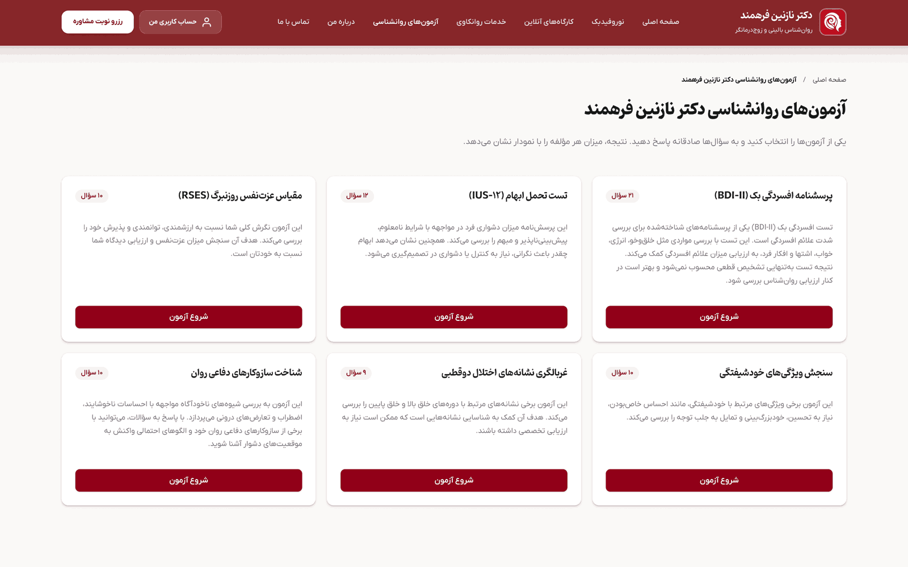
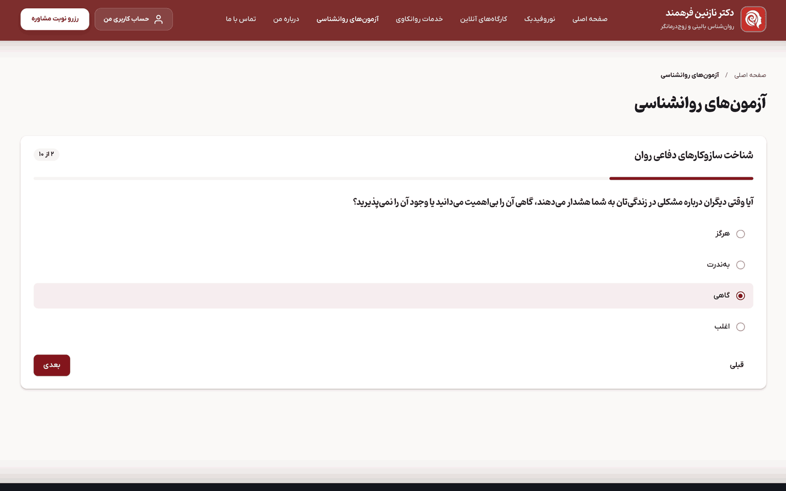
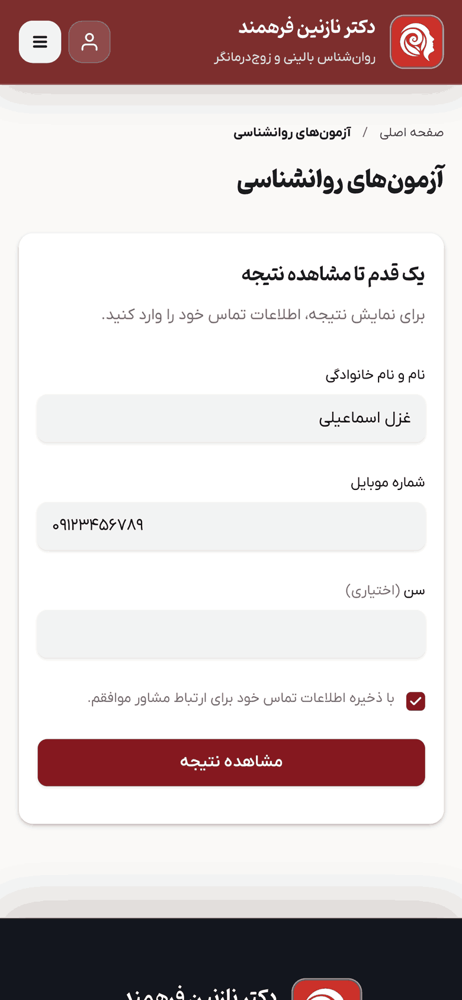
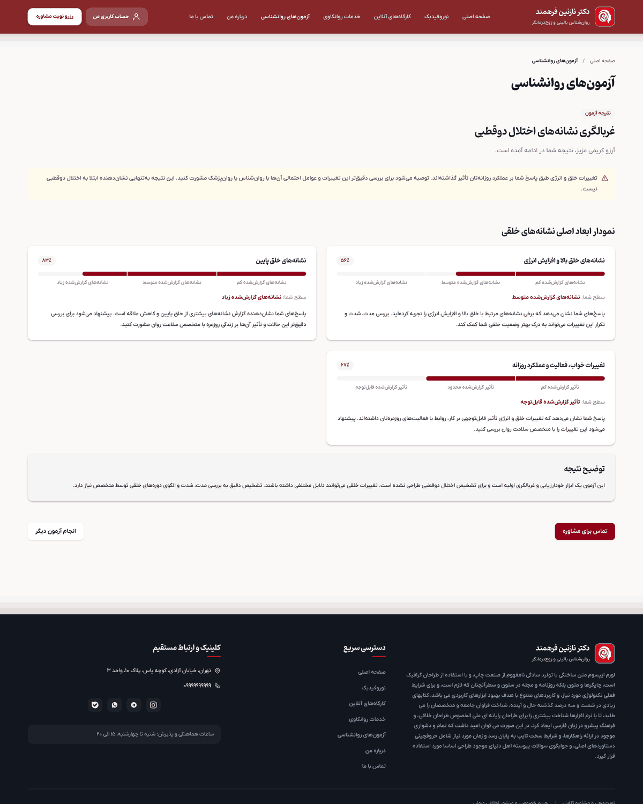
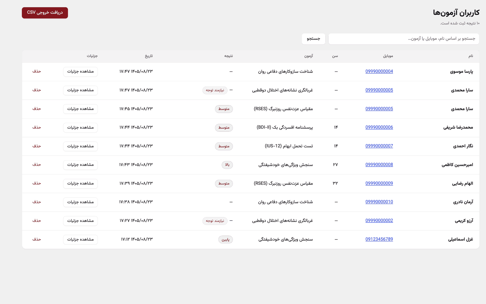
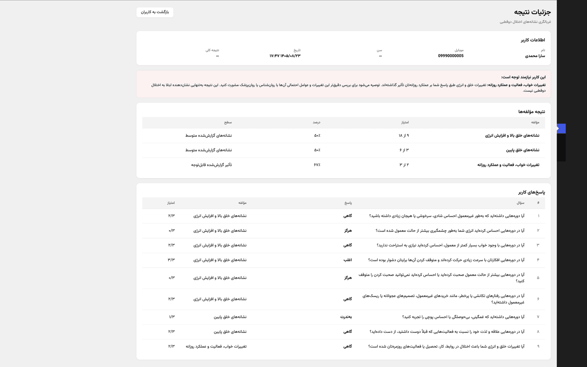
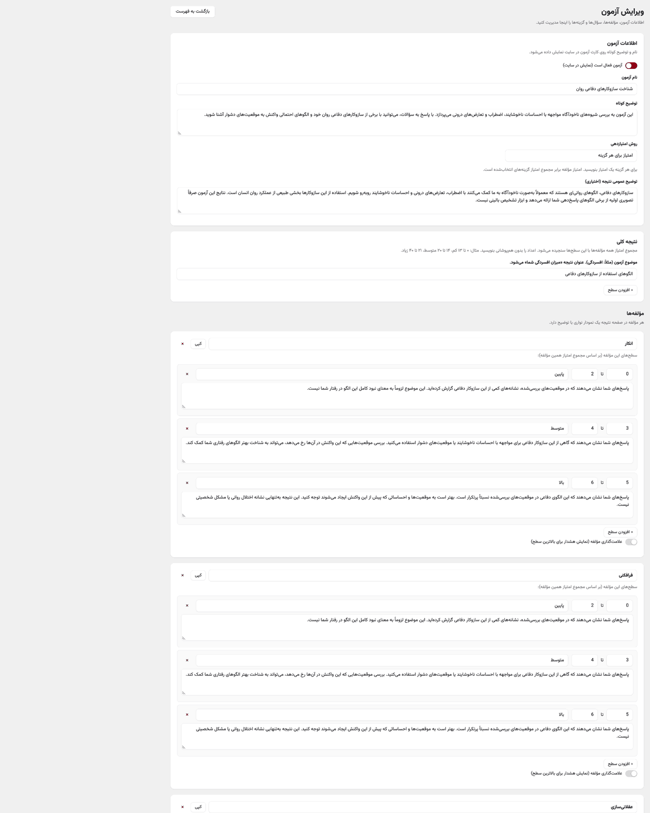
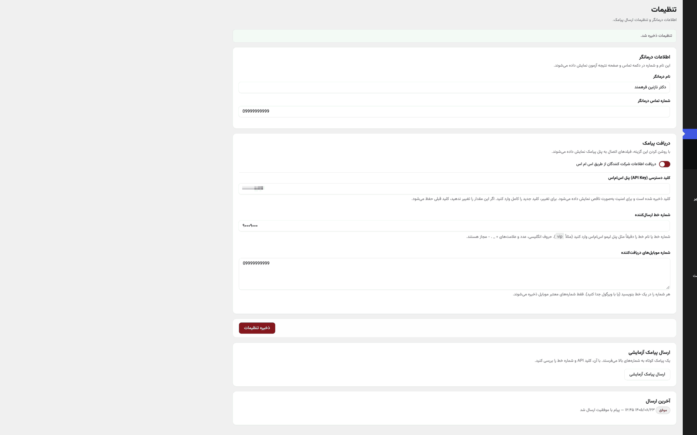

# Dozandeh Tests: psychology tests for WordPress

> I met a therapist who truly loved her job. I was supposed to build a website for her, and she came up with something I hadn't thought of: *what if visitors could take psychology tests right on the site?* That idea became this plugin, which carries her last name, *Dozandeh*, as a thank-you. With her blessing, it's now open source.

A lightweight WordPress plugin (Persian / RTL). The therapist builds her own tests in the admin, shows them on any page with one shortcode, sees every result in a dashboard and gets an **SMS alert** the moment someone finishes a test.

<!-- When the demo page is live, add: [**Live demo →**](https://gisellesmaeili.github.io/dozandeh-tests/) -->

## Built with care

- **Security:** every admin action checks capability and nonce, all SQL is prepared, and CSV export guards against formula injection
- **Spam and privacy protection:** a hidden honeypot field, a rate limit of 10 submissions per hour per IP address, and a required consent checkbox
- **No score leaks:** the public quiz endpoint never sends scores or correct answers to the browser
- **Reliable SMS:** messages go through a WP-Cron queue so visitors never wait, with an immediate-send fallback when cron is off. The API key is shown masked, and a test button and a last-result log help with debugging
- **Data safety:** data is kept when the plugin is deleted unless you opt in with a constant, and quiz saving runs in a database transaction with rollback
- **Clean structure:** one class per responsibility in `includes/`

## Features

**For visitors**
- `[dozandeh_tests]` shortcode: a clean card-based grid of published tests, then question by question with a progress bar
- Contact step (name, mobile, optional age) with a consent checkbox
- Result page with a colored bar per component, an overall result, warning notes and a closing note
- Floating "call" button showing the therapist's name and number, mobile-friendly, accessible markup (roles and ARIA)

**For the admin**
- **Test builder:** title, description, scoring mode (points per option, or right/wrong answers), components, questions, options, custom score ranges with names and descriptions, overall levels, warning text for the highest level, and a result note
- **Copy buttons** on questions and components to build long tests faster
- Publish or draft toggle for every test
- **Results dashboard:** search by name, mobile or test, a detail page with every answer and score, delete, and **CSV export**
- **Settings page:** therapist name and phone (shown on the call button), plus **SMS alerts** (LimoSMS): enable switch, masked API key, sender line, a list of receiver numbers, a "send test SMS" button and a log of the last attempt

**Under the hood**
- Public REST API: `GET /wp-json/dozandeh-tests/v1/quizzes/{id}` and `POST /wp-json/dozandeh-tests/v1/quizzes/{id}/submit`
- Validation for Iranian mobile numbers (`09xxxxxxxxx`; `+98` and Persian digits accepted)
- Four custom tables, JSON-LD `ItemList` markup for SEO

## Screenshots

| | |
|---|---|
|  |  |
|  |  |
|  |  |
|  | |

*All screenshots use sample data.*

## Installation

1. Download `dozandeh-tests.zip` from the Releases page.
2. In WordPress: Plugins > Add New > Upload Plugin, then activate.
3. Open **آزمون‌ها** in the admin menu and create a test.
4. Put `[dozandeh_tests]` on a page. Only one instance renders per page.
5. Open the settings page to set the therapist's name and phone, and optionally turn on SMS alerts.

**Requirements:** WordPress 6.3+, PHP 7.4+, a LimoSMS account for SMS.

## Customizing

| Hook | Use |
|---|---|
| `dt_phone` (filter) | Change the phone number shown on the call button |
| `dt_therapist` (filter) | Change the therapist name shown on the call button |
| `dt_sms_message` (filter) | Change the SMS text sent to the admin |

## Data and privacy

The plugin stores names, mobile numbers and test results in `{prefix}dt_*` tables. Visitors must tick a consent box. The site owner is responsible for handling this data lawfully. Data is **kept** when the plugin is deleted; to wipe it, add `define( 'DT_REMOVE_DATA_ON_UNINSTALL', true );` to `wp-config.php` before uninstalling.

## Notes

- The interface is Persian only for now (strings are not yet translatable).
- The rate limit uses the visitor's IP address. Behind a proxy that hides real IPs, visitors share one limit.
- SMS currently supports one provider: LimoSMS.

## Structure

- `includes/`: install, repository (database), REST, validator, SMS, admin, shortcode
- `templates/`: front-end markup
- `assets/`: CSS and JS for the front end and the admin

## License

GPL-2.0-or-later. See `LICENSE`.